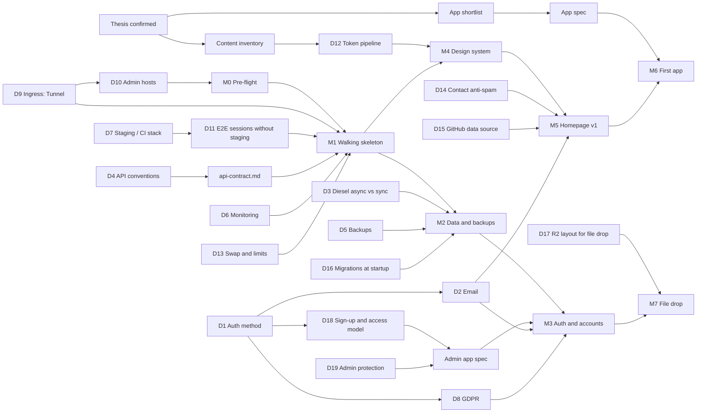

# Plan: vikingthe.dev

- **Status:** Draft. Thesis confirmed by the maintainer on 2026-10-18.
- **Date:** 2026-10-18
- **Inputs:** ADR 0001, the measured VPS and DNS zone (see `capacity.md`), and the maintainer's answers from 2026-10-18.

Companion files:

| File | Contents |
|---|---|
| `decisions.md` | Open decisions: options, recommendation, owner, the evidence that would settle each |
| `capacity.md` | Memory and CPU per service against the measured VPS |
| `apps.md` | App shortlist with scores and pitches |
| `design-sequence.md` | Content inventory → tokens → components → homepage |
| `api-contract.md` | Draft contract for the platform endpoints used by milestones 1–3 |
| `adr/0002`–`0007` | Proposed ADRs for each expensive decision |

## 1. Product thesis (confirmed 2026-10-18)

vikingthe.dev is the maintainer's home on the web: a portfolio that shows engineering skill by *being* fast, secure and well built, plus a small suite of apps the maintainer actually uses. The apps are daily puzzle games, a friends-only file drop and live distributed-systems demos. **Audience:** engineers and recruiters judging the maintainer's work (public, no account), casual players of the daily games (public, accounts optional), and friends the maintainer grants access to gated apps from `admin.vikingthe.dev`. **Non-goals:** public sign-up for anything that costs storage, monetization, ads, third-party analytics, high availability or multi-region, a CMS, native mobile apps, and any paid service beyond the existing VPS and domain. **Success metrics:**

- Field Core Web Vitals at p75 within the ADR 0001 budgets on every host, measured by our own RUM.
- External uptime of at least 99.5% a month, on one VPS with no failover.
- A merge to `main` reaches production in at most 10 minutes, with checks passed.
- The monthly run cost stays at the VPS plus the domain.
- The maintainer uses at least one app weekly.

Usage targets for the public apps get set after one month of real data, not guessed now.

## 2. Conflicts with ADR 0001

| Item | Conflict | Handling |
|---|---|---|
| No staging for now (answer C) | ADR 0001 §5 runs staging webhook → E2E → production. Staging is also named in ADR 0001 §3 (the "CI gate … staging" column and "`oha` against staging"), in its "CI guardrails" (Lighthouse "against public staging routes", "Playwright on staging"), in CLAUDE.md's checks table, in `rust.md` ("Measure with `oha` against staging") and in `frontend.md`'s budget table. | Proposed ADR 0002: an ephemeral full stack inside CI replaces staging for functional tests, and production gets post-deploy checks plus rollback. Once 0002 is accepted, 0001's status, CLAUDE.md and the rule files listed in §5 need updating. Not done yet. |
| Ingress is a Cloudflare Tunnel (DNS zone) | ADR 0001 assumes plain orange-cloud proxying to Traefik. A tunnel changes how the client IP is seen, and how TLS and origin exposure work. | Proposed ADR 0003. |
| `coolify.`, `beszel.`, `ssh.vikingthe.dev` exist (DNS zone) | They are third-party software on hosts that receive the session cookie. ADR 0001's "Revisit if" lists "subdomains host third-party content". | Decision D10, inside ADR 0003. |
| Cookie `Domain` is "exactly" `vikingthe.dev` | A future staging domain needs a different `Domain`. | ADR 0002 makes the cookie domain, and the CSRF `Origin` allowlist derived from it, a runtime config value. The production value stays exactly as written. |
| Session record gains `last_auth_at` (D19) | ADR 0001 §2 and `rust.md` define the record as exactly `{user_id, created, last_seen, ua_hash}`. Re-authentication for admin writes needs the time of the last login. | Recorded in proposed ADR 0004. `rust.md` is amended once 0004 is accepted. |
| "Draft a specific API contract" (B1) | None. The ADR 0001 tooling (utoipa → openapi-typescript → openapi-fetch) is kept. | Conventions go in proposed ADR 0006. Endpoint shapes are drafted in `api-contract.md`; `utoipa` later generates the contract from code, and the draft is the target. |
| OVH daily disk backups as the only backup (B4) | None with ADR 0001, which only requires Valkey persistence. | See D5. The maintainer waived the "real backup restore" exit check on 2026-10-18: OVH can only restore over the live disk, and this is a personal project. |

## 3. Decision dependency graph

An arrow means "must be settled before". `D` numbers refer to `decisions.md`, and `M` numbers to the milestones below.

## 4. Milestones, ordered by risk

**Every milestone starts with a decision gate.** Before any work, Claude presents that milestone's issues, concerns and major decisions, with options and a recommendation. The maintainer decides each one. Nothing on the list is resolved silently, even when `decisions.md` already holds a recommendation.

Every milestone ends with external checks. The checks used throughout are:

| Check | Where it runs |
|---|---|
| **Playwright (CI stack)** | The ephemeral full stack in CI (ADR 0002): Traefik + API + apps + Valkey + PostgreSQL + Mailpit, on `*.vikingthe.test` with a throwaway TLS cert |
| **Playwright (prod smoke)** | Production after each deploy: only checks that need no login |
| **Lighthouse CI + size-limit** | Lighthouse against the CI stack (LCP, CLS, TBT, JS bytes) and against production (TTFB through the Cloudflare cache). `size-limit` in each app's CI job |
| **oha** | From the maintainer's machine against production `/api`, and from inside the VPS against `:8081` |
| **Observatory** | Mozilla HTTP Observatory against each production host |
| **ASVS L2** | `docs/security/asvs-l2.md`, a checklist of the chapters each milestone touches, with links to the evidence |
| **axe** | `@axe-core/playwright` inside the Playwright suites, failing on any serious or critical violation |

### M0: Pre-flight (no code)

Done on 2026-10-18: disk measured (`capacity.md`), and the tunnel layout and closed firewall recorded (ADR 0003).

- Confirm once that the origin's ports 80 and 443 are closed → verify: from outside, `curl -m 5 http://<origin-ip>` and `curl -m 5 -k https://<origin-ip>` both time out.
- Apply D10 (Cloudflare Access on `coolify.`, `beszel.`, `ssh.`) → verify: an unauthenticated `curl -I https://coolify.vikingthe.dev` gets a redirect to Cloudflare Access, and the same holds for `beszel.` and `ssh.`.
- Run `cloudflared` as a dedicated unprivileged system user (the packaged systemd service) instead of `ubuntu` (D9) → verify: `ps -o user= -C cloudflared` prints the service user, and that user has no sudo rights.
- Decide D13 (swap and container limits) → verify: `swapon --show` lists the swapfile.
- Apply the repo settings in `ci-deploy.md` (secret scanning, Dependabot, branch protection) → verify: `gh api repos/:owner/:repo` shows them on.

### M1: Walking skeleton (tests every Known risk)

Scope: an empty prerendered homepage with one on-demand route and one server island; `apps/canary/` at `canary.vikingthe.dev` (a single on-demand page that renders `Astro.locals.user`; kept as the target of the synthetic checks); `crates/api` with `/api/health`, `/api/me`, `/api/auth/logout`, the CSRF middleware, the session store, and `:8081` `/health` and `/session`; and the CI → GHCR → Coolify pipeline. A second app is needed because the cross-subdomain session can't be tested with one host.

0. Write `docs/specs/canary.md` and a minimal `docs/specs/homepage.md` (one page, one on-demand route, one server island), because specs come before code → verify: both specs have an empty "Open questions" section.
1. Scaffold the Cargo and pnpm workspaces, `apps/homepage`, `apps/canary` and `crates/api` → verify: `cargo test --workspace`, `pnpm -r check` and `pnpm lint` pass locally against `compose.dev.yaml`.
2. **Known risk: does `tower-sessions` hash IDs at rest?** Read the source of the version we'd pin → verify: the answer is recorded, and the store is either `tower-sessions` or a hand-rolled store on `fred`.
3. Session issuance without an auth method: a test-only login route behind a cargo feature `e2e`, compiled only into the CI-stack image, plus an `api issue-session` CLI subcommand that only the human runs on the VPS → verify: an HTTP test asserts the production build returns 404 on the test route, and CI checks that the production image was built without the feature. The CI-stack image is built with `--load` only: it's never pushed to GHCR, and never tagged `:<sha>` or `:prod`.
4. **Known risk: does `pnpm deploy` need `inject-workspace-packages=true`?** Build the Astro images → verify: the build succeeds and the answer is recorded.
5. CI: checks → build → push `:<sha>` and `:prod` → Coolify webhook → wait for the health endpoint → verify: the workflow is green, and `/api/health` returns the pushed SHA.
6. **Known risk: does a Docker Image resource re-pull on webhook redeploy?** → verify: two consecutive deploys of different commits each change the SHA reported by `/api/health`.
7. **Known risk: does Coolify route `Host && /api` to a different resource than `/`?** → verify: `https://vikingthe.dev/api/health` and `https://canary.vikingthe.dev/api/health` return the API's SHA, while `/` on each host returns Astro.
8. **Known risk: how does a Docker Image resource reach `:8081`?** → verify: canary's server-rendered HTML shows "anonymous" within the 50 ms budget, the API logs the internal call, and `:8081` is unreachable from outside.
9. **Known risk: what cache headers does Astro send on server islands?** → verify: the `curl -I` headers of `/_server-islands/*` are recorded, and the Cloudflare bypass rule gives `cf-cache-status: DYNAMIC` or `BYPASS`.
10. **Known risk: does Universal SSL cover one subdomain level?** → verify: the certificate on `canary.vikingthe.dev` lists `*.vikingthe.dev`.
11. **New risks from the tunnel (ADR 0003):** HTTPS redirect loops between Cloudflare, cloudflared and Traefik, and the client IP → verify: no redirect loop, and API logs show the caller's real IP from `CF-Connecting-IP`.
12. **New risk: diesel-async in a distroless image (D3).** Not needed until M2, but the base image is chosen here → verify: the API image has no libpq dependency (`ldd` in the build stage).
13. Playwright (CI stack) → verify:
    - the cookie attributes match ADR 0001;
    - the session appears in canary's server-rendered HTML;
    - after logout, `/api/me` is 401 on both hosts;
    - `same-site` and `cross-site` writes get 403 while a `same-origin` control succeeds;
    - the `pagereveal` test fires a transition within the homepage and not across to canary;
    - axe passes on every page.
14. Production post-deploy → verify: the Playwright smoke suite (CSRF 403s, anonymous `/api/me` 401, health SHA) passes; Lighthouse CI meets the ADR 0001 budgets; `size-limit` passes; Mozilla Observatory gives an A+ on `vikingthe.dev` and `canary.vikingthe.dev`.
15. Human-only production session check: run `api issue-session` on the VPS, open canary in a browser, then log out → verify: the maintainer ticks the checklist (user visible in canary's server-rendered HTML, then 401 on both hosts). Claude never sees the token.
16. oha baseline → verify: `/api/health` p99 is at most 50 ms from the maintainer's machine (the result notes tunnel and network time), and `:8081/session` p99 is at most 5 ms from inside the VPS.
17. External uptime check on `/` and `/api/health` (D6) → verify: stopping canary triggers an alert email.
18. Record every Known risk outcome in a new ADR → verify: ADR 0008 exists and lists each risk as confirmed, or as falling back with the fallback applied.
19. ASVS L2 → verify: V14 (configuration) and the V3 parts the skeleton touches are ticked with evidence.

### M2: Data and backups

1. Add a PostgreSQL Coolify resource and diesel-async with a `users` table (D3, D16) → verify: migrations run, and HTTP tests pass against PostgreSQL in the CI stack.
2. Add a nightly `pg_dump` to a local volume, and turn on RDB snapshots in Valkey alongside AOF (D5) → verify: a dump file under 24 hours old exists, and Valkey's `INFO persistence` shows both on.
3. oha nightly against a read endpoint → verify: p50 ≤ 10 ms and p99 ≤ 50 ms server-side (from the API's `tracing` timings).
4. ASVS L2 → verify: V8 (data protection) for the data at rest is ticked.

The maintainer waived a backup restore drill on 2026-10-18 (D5).

### M3: Accounts, auth, email, admin, GDPR

1. Add transactional email over Proton SMTP (D2) → verify: a real email arrives from production, with SPF, DKIM and DMARC all passing in its headers.
2. Email and password sign-up with email verification, login, and password reset (D1; Argon2id in `spawn_blocking`; breached-password check per D1) → verify: the Playwright suite in the CI stack passes for sign-up, verification through Mailpit, login, logout, and reset. A reset or login issues a new session token.
3. OAuth for the providers chosen in D1 (authorization code with PKCE and `state`) → verify: Playwright against a mock OAuth provider in the CI stack completes login, and a mismatched `state` gets 403.
4. Magic-link login, if D1 keeps it → verify: Playwright logs in through a link read from Mailpit, and reusing the link gets 401.
5. Add rate limits (Valkey counters, per IP from `CF-Connecting-IP` and per account; IPv6 addresses are keyed on their /64 prefix) → verify: HTTP tests show a 429 after the limit, a different IP is unaffected, and two addresses in the same IPv6 /64 share a counter.
6. Roles and per-app access grants (D18), checked in the domain layer → verify: HTTP tests show that a user without a grant gets 403 on a gated endpoint, and that a non-admin gets 403 on every admin endpoint (IDOR and privilege tests).
7. `apps/admin` at `admin.vikingthe.dev`, after its spec: users, grants, disabling accounts and the audit log (D19; invites only if D18 lands on invite-only) → verify: the spec's acceptance criteria pass in Playwright; disabling a user revokes their sessions on every host; Cloudflare Access blocks anonymous requests; `/api/admin/*` called from `vikingthe.dev` with a valid admin session but no Access JWT gets 403.
8. GDPR: the privacy policy page, `GET /api/me/export` and `DELETE /api/me` (D8) → verify: Playwright shows the export contains every personal field and that deletion removes the user's rows, OAuth links and Valkey sessions.
9. Run `/security-review` and the `reviewer` agent → verify: no open findings.
10. ASVS L2 → verify: V2 (authentication), V3 (sessions), V4 (access control), V5 (validation) and V7 (errors and logging) are ticked with evidence.

### M4: Design system

Follows `design-sequence.md`, with a checkpoint for the maintainer at each stage → verify: tokens and components pass axe and contrast checks in both themes, and the component page meets the 15 KB JS budget in `size-limit`.

### M5: Homepage v1

Hero, portfolio (GitHub highlights fetched at build time), blog (content collections), contact form (D14), status section, terminal easter egg (loaded on demand), RUM to `/api/rum`, and a privacy policy → verify:
- Lighthouse CI and `size-limit` meet the content-route budgets, with the terminal kept out of the initial JS;
- axe passes;
- Observatory gives an A+;
- after 2 weeks, the RUM p75 values are within the field targets;
- a contact form submission arrives in the maintainer's inbox, and the 6th in a minute gets a 429.

### M6: First app (from `apps.md`, after its spec)

Spec → implementation → verify: the spec's acceptance criteria pass in Playwright; Lighthouse CI and `size-limit` meet the app-route budgets; axe passes; oha meets the API budgets on its endpoints; ASVS L2 is ticked for its chapters.

### M7 and on: further apps

Same exit checks as M6. The file drop adds upload checks (size and content type enforced server-side, R2 presigned URL expiry, quota) and an ASVS L2 V12 (files) review.

## 5. Follow-ups once proposed ADRs are accepted

- ADR 0002 accepted → mark ADR 0001 as partly superseded by 0002 (§3's staging CI gate and `oha` target, §5 "Staging" and the pipeline, and the staging parts of "CI guardrails"). Update CLAUDE.md's checks table, `ci-deploy.md`'s pipeline, `rust.md`'s `oha` line and `frontend.md`'s budget table. The maintainer approves those edits.
- ADR 0003 accepted → add the tunnel and client-IP rule to `security-code.md`.
- ADR 0004 accepted → `security-code.md` already covers Argon2id. Add the OAuth rules (PKCE, `state` bound to the browser, validated return paths, no automatic account linking). Amend the session record in `rust.md` to include `last_auth_at`.
- ADR 0005 accepted → update `rust.md`'s "PostgreSQL library isn't decided yet" line and remove the matching item from CLAUDE.md's "Stop and ask" list. The maintainer applies both.
- ADR 0006 accepted → add the conventions to `rust.md`.
