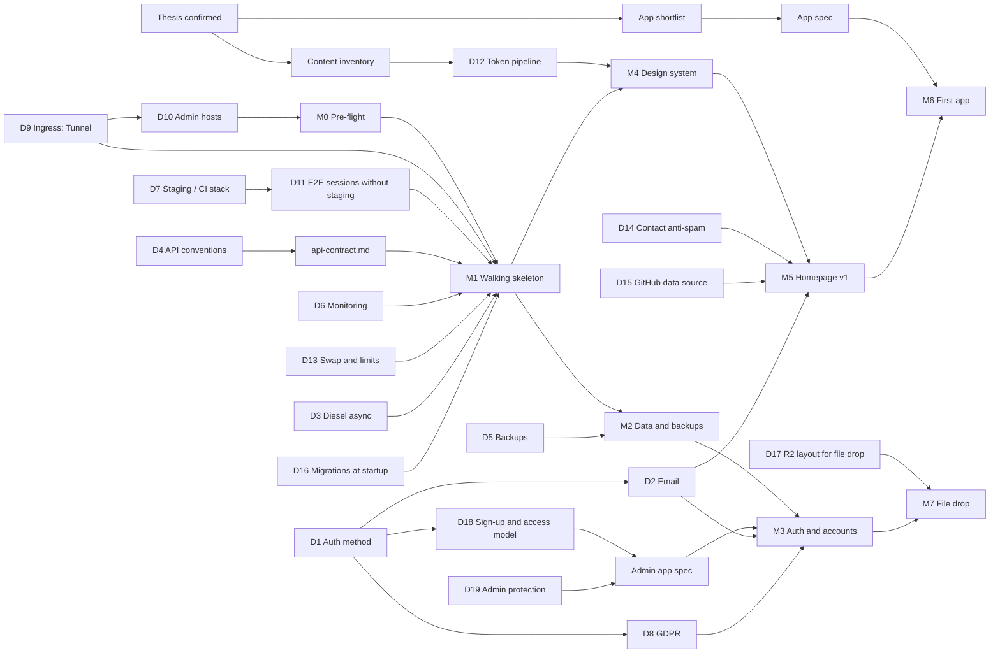

# Plan: vikingthe.dev

- **Status:** Draft. Thesis confirmed by the maintainer on 2026-10-18.
- **Date:** 2026-10-18
- **Inputs:** ADR 0001, the measured VPS and DNS zone (see `capacity.md`), and the maintainer's answers from 2026-10-18.

Companion files:

| File | Contents |
|---|---|
| `decisions.md` | Open decisions: options, recommendation, owner, the evidence that would settle each |
| `capacity.md` | Memory and CPU per service against the measured VPS |
| `apps.md` | App shortlist with scores and pitches |
| `design-sequence.md` | Content inventory → tokens → components → homepage |
| `api-contract.md` | Draft contract for the platform endpoints used by milestones 1–3 |
| `adr/0002`–`0007` | ADRs for each expensive decision (0002, 0003, 0005 and 0006 accepted; 0004 and 0007 proposed) |

## 1. Product thesis (confirmed 2026-10-18)

vikingthe.dev is the maintainer's home on the web: a portfolio that shows engineering skill by *being* fast, secure and well built, plus a small suite of apps the maintainer actually uses. The apps are daily puzzle games, a friends-only file drop and live distributed-systems demos. **Audience:** engineers and recruiters judging the maintainer's work (public, no account), casual players of the daily games (public, accounts optional), and friends the maintainer grants access to gated apps from `admin.vikingthe.dev`. **Non-goals:** public sign-up for anything that costs storage, monetization, ads, third-party analytics, high availability or multi-region, a CMS, native mobile apps, and any paid service beyond the existing VPS and domain. **Success metrics:**

- Field Core Web Vitals at p75 within the ADR 0001 budgets on every host, measured by our own RUM.
- External uptime of at least 99.5% a month, on one VPS with no failover.
- A merge to `main` reaches production in at most 10 minutes, with checks passed.
- The monthly run cost stays at the VPS plus the domain.
- The maintainer uses at least one app weekly.

Usage targets for the public apps get set after one month of real data, not guessed now.

## 2. Conflicts with ADR 0001

| Item | Conflict | Handling |
|---|---|---|
| No staging for now (answer C) | ADR 0001 §5 runs staging webhook → E2E → production. Staging is also named in ADR 0001 §3 (the "CI gate … staging" column and "`oha` against staging"), in its "CI guardrails" (Lighthouse "against public staging routes", "Playwright on staging"), in CLAUDE.md's checks table, in `rust.md` ("Measure with `oha` against staging") and in `frontend.md`'s budget table. | ADR 0002 (accepted 2026-10-19): an ephemeral full stack inside CI replaces staging for functional tests, and production gets post-deploy checks plus rollback. 0001's status, CLAUDE.md and the rule files listed in §5 are updated. |
| Ingress is a Cloudflare Tunnel (DNS zone) | ADR 0001 assumes plain orange-cloud proxying to Traefik. A tunnel changes how the client IP is seen, and how TLS and origin exposure work. | ADR 0003 (accepted 2026-10-19). |
| `coolify.`, `beszel.`, `ssh.vikingthe.dev` exist (DNS zone) | They are third-party software on hosts that receive the session cookie. ADR 0001's "Revisit if" lists "subdomains host third-party content". | Decision D10, inside ADR 0003. |
| Cookie `Domain` is "exactly" `vikingthe.dev` | A future staging domain needs a different `Domain`. | ADR 0002 makes the cookie domain, and the CSRF `Origin` allowlist derived from it, a runtime config value. The production value stays exactly as written. |
| Session record gains `last_auth_at` (D19) | ADR 0001 §2 and `rust.md` define the record as exactly `{user_id, created, last_seen, ua_hash}`. Re-authentication for admin writes needs the time of the last login. | Recorded in proposed ADR 0004. `rust.md` is amended once 0004 is accepted. |
| "Draft a specific API contract" (B1) | None. The ADR 0001 tooling (utoipa → openapi-typescript → openapi-fetch) is kept. | Conventions are in ADR 0006 (accepted 2026-10-19). Endpoint shapes are drafted in `api-contract.md`; `utoipa` later generates the contract from code, and the draft is the target. |
| OVH daily disk backups as the only backup (B4) | None with ADR 0001, which only requires Valkey persistence. | See D5. The maintainer waived the "real backup restore" exit check on 2026-10-18: OVH can only restore over the live disk, and this is a personal project. |

## 3. Decision dependency graph

An arrow means "must be settled before". `D` numbers refer to `decisions.md`, and `M` numbers to the milestones below.

## 4. Milestones, ordered by risk

**Every milestone starts with a decision gate.** Before any work, Claude presents that milestone's issues, concerns and major decisions, with options and a recommendation. The maintainer decides each one. Nothing on the list is resolved silently, even when `decisions.md` already holds a recommendation.

Every milestone ends with external checks. The checks used throughout are:

| Check | Where it runs |
|---|---|
| **Playwright (CI stack)** | The ephemeral full stack in CI (ADR 0002): Traefik + API + apps + Valkey + PostgreSQL + Mailpit, on `*.vikingthe.test` with a throwaway TLS cert |
| **Playwright (prod smoke)** | Production after each deploy: only checks that need no login |
| **Lighthouse CI + size-limit** | Lighthouse against the CI stack (LCP, CLS, TBT, JS bytes) and against production (TTFB through the Cloudflare cache). `size-limit` in each app's CI job |
| **oha** | From the maintainer's machine against production `/api`, and from inside the VPS against `:8081` |
| **Observatory** | Mozilla HTTP Observatory against each production host |
| **ASVS L2** | `docs/security/asvs-l2.md`, a checklist of the chapters each milestone touches, with links to the evidence |
| **axe** | `@axe-core/playwright` inside the Playwright suites, failing on any serious or critical violation |

### M0: Pre-flight (no code)

**Done on 2026-10-18.** Decisions taken at the M0 gate:

1. Cloudflare Access gets a Bypass rule for `coolify.vikingthe.dev/api/v1/deploy` only, so CI's deploy webhook works. Coolify's API token still protects that path.
2. Access logs in with an emailed one-time PIN, with Cloudflare as a second login option.
3. A 4 GiB swapfile with `swappiness=10`.
4. Branch rules block force-pushes and deletion of `main` now. Required PRs and status checks come in M1, once CI exists.
5. The repo is public.
6. OVH's edge firewall is the only layer in front of Docker-published ports (D20).

Results:

- Ports → done: external probes found 22, 80, 443, 6001, 6002, 8000, 8080 and 52843 (sshd) closed or filtered on IPv4. The VPS has no public IPv6.
- Cloudflare Access on `coolify.`, `beszel.`, `ssh.` (D10) → done: unauthenticated requests redirect to Cloudflare Access, and `/api/v1/deploy` reaches Coolify, which answers 401 without its token.
- `cloudflared` off root (D9) → done:
  - all four tunnels run as the unprivileged `cloudflared` user, under hardened systemd units, with `protocol: http2`;
  - that user has no sudo rights;
  - the hand-installed `/usr/local/bin/cloudflared` is replaced by the apt package;
  - the token-based ssh tunnel was replaced by a new tunnel, and the old one deleted, which rotates its partly exposed token.
- Swap (D13) → done: `swapon --show` lists the 4 GiB swapfile. The maintainer sets container memory limits per resource when creating each one in M1 and M2.
- Repo settings → done: secret scanning and push protection, Dependabot alerts and security updates, private vulnerability reporting, and a ruleset blocking deletion and force-pushes on `main`. `SECURITY.md` is added.

### M1: Walking skeleton (tests every Known risk)

Scope: an empty prerendered homepage with one on-demand route and one server island; `apps/canary/` at `canary.vikingthe.dev` (a single on-demand page that renders `Astro.locals.user`; kept as the target of the synthetic checks); `crates/api` with `/api/health`, `/api/me`, `/api/auth/logout`, the CSRF middleware, the session store, a one-table `users` schema in PostgreSQL, and `:8081` `/health` and `/session`; and the CI → GHCR → Coolify pipeline. A second app is needed because the cross-subdomain session can't be tested with one host.

**Decisions taken at the M1 gate (2026-10-19):**

1. ADRs 0002, 0003, 0005 and 0006 are accepted, with the follow-ups in §5 applied. 0004 and 0007 wait for M3.
2. The session store is hand-rolled on the `redis` crate (step 2's answer, below). `fred` was rejected: its last release was 2025-02-27, while `redis` releases every few weeks.
3. PostgreSQL, diesel-async and a one-table `users` schema come into M1, so the skeleton crosses every layer. Migrations run at startup under an advisory lock (D16).
4. Security headers: one Cloudflare response-header rule for every host (HSTS, `nosniff`, `Referrer-Policy`, `Permissions-Policy`, CSP `frame-ancestors 'none'`), and the per-page CSP from Astro as hashes in a `<meta>` tag. The Cloudflare config is written down in `docs/edge-config.md`. HSTS carries `preload`. Submitting the domain to the preload list isn't needed: `.dev` is preloaded as a whole TLD.
5. Third-party GitHub Actions: the list in `ci-deploy.md`, each pinned to a commit SHA and named in the commit that adds it. Any action not on the list is still stop-and-ask.
6. The `main` ruleset requires a PR and the CI checks, with no approvals and no bypass. Claude creates commits; only the maintainer pushes.
7. UptimeRobot's free tier (D6).
8. Lighthouse CI reports go to GitHub Actions artifacts only.
9. M1 is split into three PRs: M1a (local), M1b (production, opened by a short gate of its own) and M1c (records).

**M1a: local, nothing touches production**

0. Write `docs/specs/canary.md` and a minimal `docs/specs/homepage.md` (one page, one on-demand route, one server island), because specs come before code → verify: both specs have an empty "Open questions" section.
1. Scaffold the Cargo and pnpm workspaces, `apps/homepage`, `apps/canary`, `crates/api` and `compose.dev.yaml` → verify: `cargo test --workspace`, `pnpm -r check` and `pnpm lint` pass locally against `compose.dev.yaml`, and whether Astro 7 reads `security.allowedDomains` at build time is recorded.
   - **Result (2026-10-19):** Astro 7 reads `security.allowedDomains` at build time (its build manifest plugin copies it from the config), so each app's config lists its production host and its `.test` host. Astro 7's CSP option is `security.csp`, no longer experimental (input for step 5). pnpm 11+ replaced `onlyBuiltDependencies` with `allowBuilds` (the old key is silently ignored); `strictDepBuilds` makes an unapproved install script fail the install. MinIO is left out of `compose.dev.yaml` until an app uses R2. `@astrojs/node` enables Astro's own sessions unless `session: false`, so both apps set it. `compose.dev.yaml` was validated with `docker compose config` only; the sandbox can't reach Docker, so the maintainer starts it.
2. **Known risk: does `tower-sessions` hash IDs at rest?** **Answered on 2026-10-19: no.** `tower-sessions-redis-store` 0.16.0 uses the raw ID as the Valkey key, the 0.15.0 core draws IDs from `rand::rng()` rather than `OsRng`, and there's no per-user index for revoking all of a user's sessions. Build the store from `rust.md` on the `redis` crate, plus the session cookie, `POST /api/auth/logout` and the CSRF middleware (step 2 gate, 2026-10-19) → verify: tests against real Valkey show it holds only `sha256(token)` keys, that revoking a user deletes every one of their sessions and no one else's, and that logout deletes the session server-side; HTTP tests show `same-site` and `cross-site` writes get 403 while `same-origin` succeeds.
3. Session issuance without an auth method: a test-only login route behind a cargo feature `e2e`, compiled only into the CI-stack image, plus an `api issue-session` CLI subcommand that only the human runs on the VPS → verify: an HTTP test asserts the production build returns 404 on the test route, and CI checks that the production image was built without the feature. The CI-stack image is built with `--load` only: it's never pushed to GHCR, and never tagged `:<sha>` or `:prod`. **Step 3 gate (maintainer, 2026-10-19):** both the test login (`{ display_name }`) and `api issue-session --display-name <name>` create a new user and a session for it, and step 6 adds writing the users row. Arguments are parsed by hand, with no new dependency. **Done here:** the HTTP tests for both builds. **Still to come:** the CI check on the production image, with the CI workflows.
4. **Known risk: does `pnpm deploy` need `inject-workspace-packages=true`?** Build the Astro images → verify: the build succeeds and the answer is recorded. **Step 4 gate (maintainer, 2026-10-19):** one shared `docker/astro.Dockerfile`; the API image (`docker/api.Dockerfile`, cargo-chef on distroless `cc`) is built here too; both apps gain `GET /health` returning the build's SHA, for the deploy wait. **Answer:** `pnpm deploy --prod` works on pnpm 12.14 without `inject-workspace-packages`, while no app depends on a workspace package; recheck when one does. **Built and smoke-tested by the maintainer (2026-10-19):** all three images run with a read-only root filesystem, and every health endpoint reports the build SHA. Compressed sizes: API 12 MB; each Astro image 101 MB, mostly Astro's production `node_modules`. Slimming the Astro images is a later item.
5. **Known risk: Astro 7's config key for CSP hashes** (`security-code.md` calls it unverified) → verify: the built HTML carries a CSP `<meta>` with `script-src` hashes and no `unsafe-inline`, and the server island and hydration scripts still run. **Step 5 gate (maintainer, 2026-10-19):** a strict baseline (`default-src 'self'; object-src 'none'; base-uri 'none'; form-action 'self'; img-src 'self' data:; connect-src 'self'`) shared from `@vikingthedev/config/csp`; the homepage server island ("anonymous" until step 6) and canary's logout island (`openapi-fetch`) are built here. **Answer:** the key is `security.csp`. Prerendered pages get a `<meta>`; on-demand pages get a response header, hashed per response, so the Cloudflare `frame-ancestors` rule must add a header, never replace one. A hash check showed every inline script and style covered, with no `unsafe-inline`; the browser check is step 7's Playwright run. Canary's JS is about 14 KB gzipped, against a 15 KB budget. The first workspace dependencies are devDependencies only, and the maintainer's image rebuild confirmed that `pnpm deploy --prod` still works: both images serve `/health` and their CSP (2026-10-19). Server islands take no props or slots, because the build-time island key is effectively public (`security-code.md`).
6. **diesel-async in a distroless image (ADR 0005).** Use `deadpool` (maintainer, 2026-10-19). Build `/api/me` and the internal `:8081` `/session` here, since both need `users` (step 2 gate). The `users` migration runs at startup under an advisory lock → verify: `ldd` on the API binary (in the build stage) shows no libpq; two API containers starting at once apply the migration exactly once; `/api/me` returns the user from PostgreSQL; `:8081` `/session` returns `SessionUser`, with `role: "user"` and `grants: []` until M3. Also here: a UUIDv7 request-ID layer on both listeners that sets `X-Request-Id` on every response and `instance: "urn:uuid:<id>"` on problems (ADR 0006; deferred from step 2, 2026-10-19), and session loading that treats more than one distinct session token as unauthenticated → verify: HTTP tests show both headers and the `instance`, and that `/api/me` returns 401 with two valid session cookies. **Step 6 gate (maintainer, 2026-10-19):** two commits, 6a (API) then 6b (Astro middleware and pages); PostgreSQL over plain TCP on the host's internal Docker network, with TLS mandatory if it ever moves off-host and its port never published; `schema.rs` hand-written for now, rather than generated by the diesel CLI as ADR 0005 describes, with tests reading every column back. **6a done:** `ldd` on the release binary shows no libpq; the request ID is always generated, never taken from the request. Database calls time out after 500 ms on the client side only, so set a server-side `statement_timeout` in production's `DATABASE_URL` (step 6a review). **6b gate (maintainer, 2026-10-19):** the Astro session code lives in a new `@vikingthedev/session` package, bundled into each app at build time; middleware forwards only the `__Secure-vt_sid` cookies, repeats included. **6b done:** `API_INTERNAL_URL` is read at run time and defaults to the local API, so production must set it (step 11); a failed lookup logs only its status or error name. `@types/node` (for the package's typed tests) is an optional peer of `vite` and `sharp`, so `pnpm deploy --prod` now puts about 2.7 MB of type definitions in each Astro image; accepted, since they never run (maintainer, 2026-10-19). The links and `@view-transition` that step 7's `pagereveal` test needs are not built yet.
7. Playwright (CI stack) → verify:
   - the cookie attributes match ADR 0001;
   - the session appears in canary's server-rendered HTML;
   - after logout, `/api/me` is 401 on both hosts;
   - `same-site` and `cross-site` writes get 403 while a `same-origin` control succeeds;
   - the `pagereveal` test fires a transition within the homepage and not across to canary;
   - axe passes on every page;
   - Lighthouse CI (lab budgets) and `size-limit` pass.

   **Step 7 gate (maintainer, 2026-10-19):** two commits: 7a builds the CI stack (`compose.ci.yaml`: Traefik, the API with `e2e`, both apps, PostgreSQL and Valkey; Mailpit waits for M3) plus the Playwright and axe suite, and 7b adds `size-limit` and the Lighthouse budgets. The shared layout with `@view-transition` lives in a new `packages/ui`. Playwright runs in its pinned container on the compose network, where Traefik answers as `*.vikingthe.test` through network aliases, so no host needs `/etc/hosts` entries. Chromium only: Firefox has no cross-document view transitions. Lighthouse runs only in CI through `treosh/lighthouse-ci-action`, wired up in step 8. **7a done:** `scripts/ci-stack` passes all 22 tests on the maintainer's machine (2026-10-19). Cross-app links read a run-time `PLATFORM_URL` (validated as a URL at startup), so one image links correctly in production and in the CI stack. The sibling-subdomain CSRF test grants Chromium's `local-network-access` permission, because the stack runs on a private network; production hosts are public. **7b gate (maintainer, 2026-10-19):** `size-limit` measures all of an app's `/_astro/*.js` against one budget per app, an upper bound on any route, while Lighthouse measures the script requests of each URL (inline scripts count toward the document, not this budget). "15 KB" means 15,000 bytes in both gates (step 7b review). The Lighthouse assertions (ADR 0001 §3: LCP ≤ 2.0 s, TBT ≤ 100 ms, CLS ≤ 0.05, server response ≤ 400 ms, script ≤ 15,000 bytes) are committed in `packages/config/lighthouserc.json` and first run in step 8, which also decides how the runner reaches the stack; the 200 ms edge-cache TTFB is checked only in production (step 16). Image builds set `ASTRO_TELEMETRY_DISABLED=1`. **7b done:** homepage 9.8 kB and canary 14.7 kB of a 15 kB budget; canary has almost no headroom, so its next island needs a budget decision. A budget lowered below the current size makes `pnpm size` fail. **For step 8 (7b review):** Lighthouse's script size is transfer bytes, and nothing in the CI stack compresses, so add a Traefik `compress` middleware (`encodings: [gzip]`) on the app routers or both apps fail on raw JS; transfer bytes also include a few hundred header bytes, which matters for canary's headroom. Confirm that the Lighthouse version bundled with the pinned treosh action still emits `server-response-time` and `resource-summary`. Once an app route exists, ADR 0001's `assertMatrix` needs per-host entries.

**M1b: production** (opens with its own gate: Coolify resource setup, the GitHub `production` environment, and the Cloudflare rules)

**M1b gate (maintainer, 2026-10-19):** the GHCR images are public, since the repo is public and images hold no secrets, so Coolify pulls without a registry credential. One `ci.yml`: checks run on every PR and push, and the deploy jobs `needs:` them and run only on pushes to `main` under the `production` environment. M1b is committed on an `m1b` branch and reaches `main` by PR. Order: (1) the PR checks and the runbooks for the maintainer's console work, (2) the maintainer creates the Coolify resources and Cloudflare rules from the runbooks, (3) the deploy jobs, the first deploy and steps 9–14, (4) headers, smoke checks, oha and uptime. Defaults: Lighthouse reaches the CI stack through Traefik published on `127.0.0.1:443` with `/etc/hosts` entries on the runner and gzip in Traefik; the production smoke checks reuse `e2e/` with hosts from the environment.

**M1b phase 1:** `.github/workflows/ci.yml` runs the checks on every PR and push to `main`. A `changes` job (`dorny/paths-filter`, PRs only) gates the `rust`, `contract`, `js` and `e2e` jobs; pushes to `main` and edits to the workflow run everything. `cargo-deny` and `gitleaks` always run, and `checks-passed` is the one required check: it fails unless `changes`, `cargo-deny` and `gitleaks` succeeded and nothing else failed or was cancelled. gitleaks runs as a pinned binary with a checksum check rather than `gitleaks/gitleaks-action`, which scans only a PR's commits; `oasdiff breaking` runs the same way against the base branch's `openapi.json`. The `e2e` job runs `scripts/ci-stack` in stages (`up`, `test`, `down`), publishes Traefik on `127.0.0.1:443` (`CI_STACK_HTTPS_PORT`; unset, Docker picks a free loopback port), and runs Lighthouse on `/` and `/account` of the homepage and `/` of canary, with reports as artifacts only; Traefik now gzips the app routes. The runbooks are `docs/production-setup.md` (Coolify, GitHub) and `docs/edge-config.md` (Cloudflare). Default chosen there, to confirm in phase 2: images at `ghcr.io/vikingthedev/vikingthedev-platform/<target>`. The edge cache is an allow-list of prerendered paths, so a forgotten on-demand route stays uncached (phase 1 review). **Open for phase 3:** production's server-side `statement_timeout` needs `run_migrations` to lift it on its own connection first, or a long migration and the migration-lock wait would hit it (phase 1 review). **After the merge (2026-10-23):** `cargo deny` failed on `main` with RUSTSEC-2026-0385 (`ctutils` 0.4.3, under `sha2` and `hmac`). The fix, `ctutils` 0.4.4, came out the same day; the maintainer approved taking it at once, a security exception to waiting two weeks before taking a new release. 0.4.5, released that day too, is not taken yet.

**Phase 3 split (maintainer, 2026-10-23):** the app resources need images before they can be created, so phase 3a adds a `publish` job first. On pushes to `main`, after `checks-passed`, it builds the three images, rejects an API image whose binary contains the e2e `/test/login` route, pushes `:<sha>` to GHCR with `GITHUB_TOKEN` (no secrets), then points `:prod` at the pushed digest. The maintainer then makes the packages public, creates the app resources and deploys once by hand, which also tests steps 9–11. Phase 3b adds the webhook deploy, health wait, cache purge, smoke checks and rollback. Phase 3a review: the e2e check runs on a locally loaded build before anything is pushed, then an identical cached build pushes, and `:prod` moves to the pushed digest. For 3b: re-running an old `main` run moves `:prod` back to that commit, so 3b's step of recording the current `:prod` digest before retagging must cover re-runs too. **Step 14, ingress half (2026-10-23):** the apps tunnel's only ingress rule is `http://localhost:80`, and its live log confirms `originService: http://localhost:80` for `vikingthe.dev`, so Coolify domains use `http://`. The log's message line reads `localhost:8080` regardless, which looks like a cloudflared display quirk. The redirect-loop check waits for the first deploy. Port 8080 was published on `0.0.0.0` by `coolify-proxy`, whose command line defines only the `:80` and `:443` entrypoints (`--api.insecure=false`), so nothing should have listened behind it, and only the OVH edge firewall closed it (D20); the maintainer has since removed the mapping (2026-10-23).

**Phase 2 done (maintainer, 2026-10-23):** the maintainer finished the runbook checklist, and the first deploy was by hand. Checked from outside: `/` on both hosts is Astro, while `/api/health` on both returns the API's SHA, so Coolify routes `Host && /api` to a different resource than `/` (**step 10 confirmed**). Canary's server-rendered HTML shows "anonymous", and `API_INTERNAL_URL` is `http://<api-uuid>:8081`, on the belief that the resource's UUID is a stable alias on the `coolify` network (**step 11: reachable**, which was wrong: no lookup was made, and the UUID never resolved; see **Phase 4a deployed**; the 50 ms budget, the API logging the internal call, and `:8081` being unreachable from outside are still to check). `http://` gets one 301 to `https://`, and every HTTPS page answers 200 (**step 14: no redirect loop**; the client-IP half waits for the API to read `CF-Connecting-IP`). `/` is a cache `HIT`; `/account`, canary, `/health` and `/api/health` are `DYNAMIC`. Canary carries both Astro's CSP header and the added `frame-ancestors` one, and HSTS, `nosniff`, `Referrer-Policy` and `Permissions-Policy` are present (step 15 still needs the Observatory A+ and the edge-config match). Coolify 4.4.6 rejects `--security-opt=no-new-privileges` in Custom Docker Options (`invalid security-opt: "\"no"`), so the maintainer dropped it from the three app resources, and the databases run without it. `docker inspect` shows `CapDrop: [ALL]` on the three app containers, but `ReadonlyRootfs: false`: Coolify silently drops `--read-only`. The maintainer accepted the writable root filesystem (2026-10-23); the images are distroless and run as `nonroot`, so the app process can't modify its binary, `node_modules` or system files (it can still write `/tmp` and its home directory). **Open:**
- `no-new-privileges` on all five containers. The candidate fallback is Docker's daemon-wide `"no-new-privileges": true` in `/etc/docker/daemon.json`, which needs no Coolify option and covers the databases too; the maintainer approved it (2026-10-23), and it isn't applied yet: ADR 0009 defers it to a planned window.

**First automatic deploy (2026-10-23):** every target was built, as designed, because the merge changed the workflow. All three deploys failed at the webhook with HTTP 405: Coolify 4.4.6 accepts only `POST /api/v1/deploy` (its `GET` route returns `post_required`), and `scripts/release` sent `GET`. Each rollback put `:prod` back on its recorded digest, and Coolify never redeployed, so production didn't change. `scripts/release` now sends `POST`.

**Rollback drill (step 8):** waived by the maintainer on 2026-10-23. The 405 failures above exercised the retag back to the recorded digest, but not the rollback's redeploy, health wait or purge.

**Phase 4 gate (maintainer, 2026-10-23):** three PRs. 4a: the API reads the client IP (step 14) and logs every request (step 11). 4b: production smoke checks (step 16: a no-login subset of `e2e/`, Lighthouse with edge TTFB, and Mozilla Observatory, step 15), with a failure triggering the rollback. 4c: the maintainer's runbook steps 17–19. The CI stack trusts `X-Real-Ip`, which Traefik overwrites with the peer address; production trusts `CF-Connecting-IP`. Logs keep the full IP, since they stay in Docker on the VPS.

**Phase 4a:** both listeners log one `request` line per request (method, path without the query string, status, `elapsed_ms`) inside the request span, which carries `request_id` and, on `:8080` only, `client_ip` from the header named by `CLIENT_IP_HEADER`. A missing, repeated or malformed header leaves `client_ip` out, and the request proceeds; the /64 prefix and rejecting rate-limited requests without the header arrive with the rate limits (M3 step 5). **For the maintainer:** add `CLIENT_IP_HEADER` to the API resource before merging (`production-setup.md`); then check step 14 (a `curl` of `/api/health` logs your own IP), and step 11 (a canary page load logs the internal `/session` call and its `elapsed_ms`, and `curl --max-time 5 http://<vps-ip>:8081/health` from outside fails).

**Phase 4a deployed (2026-10-23):** the first deploy failed its health wait because the API resource lacked `CLIENT_IP_HEADER`, so the new API exited at startup. CI rolled back on its own: retag, redeploy and health wait all ran for real, and `/api/health` reported the previous SHA again (the API has no purge host). In the minutes between, `/api/health` answered Astro's 404, presumably because Coolify's proxy drops a resource's routes while it has no container. After the maintainer added the variable, re-running the failed job deployed `f1224ce`. **Step 9 confirmed:** two webhook deploys of different commits each changed the SHA (`59a93ac`, deployed by the webhook after the `POST` fix, then `f1224ce`). **Step 14 done:** a `curl` from the maintainer's machine logs their own IP as `client_ip`. **Step 11 done, after a fix, except the 50 ms budget (step 18):** the UUID alias from phase 2 never existed. The API container's only DNS names are its per-deploy container name and its short ID, so every lookup from canary failed with `TypeError`. Phase 2 missed it because the middleware calls the API only when a request carries a session cookie, so an anonymous page proves nothing. ADR 0001's stated fallback, attaching a shared Docker network by hand, didn't apply: both containers already share the `coolify` network, and only a stable name was missing. The substitute fix is a Coolify *Network Alias*, `vikingthedev-api`, on the API resource, with `API_INTERNAL_URL=http://vikingthedev-api:8081` on both apps; ADR 0009 will record that it replaced the stated fallback (step 20). With a dummy session cookie, canary's five requests each logged a `/session` call on `:8081` (401, no `client_ip`, about 0.015 ms server-side, since the dummy value, `not-a-real-token`, is malformed and rejected before any Valkey lookup) and no `session lookup failed`; `:8081` and `:8080` time out from outside. Step 18 measures a real lookup against the 5 ms budget. A broken internal URL degrades every page to anonymous by design, so smoke checks can't see it; step 17's session check is the end-to-end proof.

**Phase 4b gate (maintainer, 2026-10-24):** smoke checks run in each deploy job, after the health wait and purge, and a failure triggers that job's rollback. Deploys run one at a time, because a redeploying API briefly 404s on `/api`, which would fail another target's checks. A production Lighthouse miss turns the run red without rolling back: ADR 0008 supersedes that part of ADR 0002 point 2. The smoke suite is the existing e2e suite: `PLATFORM_DOMAIN` (default `vikingthe.test`) picks the hosts, tests safe in production carry `@smoke`, and Cloudflare-only tests carry `@production` as well, which the CI stack skips. Against production, the config runs only `@smoke` and validates TLS certificates. Smoke also runs after a failed purge (maintainer, 2026-10-24), since stale cached HTML can point at assets the new image lacks; a cancelled or timed-out smoke step (6 minutes) rolls back too, and the deploy job's limit rose to 30 minutes so a rollback can finish.

**Phase 4b:** `scripts/ci-stack smoke` runs the 23 `@smoke` tests, including `/api/me` returning 401 without a session on both hosts, in the pinned Playwright container, with the repo mounted read-only, so the tests can't alter the rollback's scripts. The new `edge.spec.ts` asserts `edge-config.md`'s security headers on both hosts, the edge's `frame-ancestors` CSP beside Astro's hashed one on canary, a cache `HIT` on `/` and `DYNAMIC` or `BYPASS` on canary and the health endpoints, plus Mozilla Observatory's A+ for both hosts. A `lighthouse-production` job runs after a successful deploy on the three URLs, adding ADR 0001's 200 ms TTFB for the edge-cached `/` (`lighthouserc.json`; the 400 ms budget still covers every URL). The axe check splits into logged-out (`@smoke`) and logged-in tests. **Step 15 done (2026-10-24):** Observatory gives A+ to `vikingthe.dev` (130) and canary (125), and the 13 request-only smoke tests, `edge.spec.ts` included, passed against production from a Claude session on the maintainer's machine, so the live rules match `edge-config.md`; the `/api/me` tests passed there too. The browser tests first run against production in CI. The smoke checks can't see a broken `API_INTERNAL_URL` (phase 4a deployed), so step 17 remains the end-to-end session proof.

**Phase 4c (2026-10-24), steps 16–19 done:** **Step 16 done:** on the merge of phase 4b (`d7c85ff`, run 40033429459), every deploy job's smoke checks passed, nothing rolled back, and `lighthouse-production` passed. **Step 17 done:** the maintainer issued a session with `docker exec` into the API container, set the cookie by hand, saw their name in canary's server-rendered HTML and on `/account`, logged out, and got 401 from `/api/me` on both hosts; Claude never saw the token. **Step 18 done:** step 17's logout deleted its session, so the maintainer issued a second one the same way, sent its cookie with both VPS runs, and logged out afterwards. Canary's run, with a session and so a superset of step 11's anonymous path, closes step 11's 50 ms budget.

| Measurement | Responses | p50 | p99 | Gate |
|---|---|---|---|---|
| `:8081/session`, from the VPS (`-n 2000 -c 10`) | 2,000 × 200 | 0.89 ms | 1.72 ms | ≤ 5 ms, met |
| canary `/` SSR with the session, from the VPS (`-n 500 -c 5`) | 500 × 200 | 6.7 ms | 24.0 ms | ≤ 50 ms, met |
| `https://vikingthe.dev/api/health`, from the maintainer's machine (`-n 1000 -c 10`) | 1,000 × 200 | 73 ms | 147 ms | baseline only |

The external run can't meet a 50 ms p99: its fastest request took 62 ms, against a 24 ms ping to the nearest Cloudflare location and 65 ms to the Frankfurt origin, which suggests the Cloudflare-to-Frankfurt leg sets the floor. The maintainer made it a regression baseline without a gate, and the in-network runs carry the budgets (2026-10-24). `oha` ran on the VPS as the release binary in `/tmp`, removed afterwards. The first canary run was refused on 4321: canary's *Ports Exposes* was `80`, and the container listened on 80, with Traefik's label on 80 too, rather than the image's 4321. The maintainer set it to `4321` as `production-setup.md` says; `ss -tln` inside canary's network namespace (`nsenter`) now shows 4321. The measured run above used port 80, before the fix. Homepage's *Ports Exposes* was already `4321`. **Step 19 done:** UptimeRobot monitors `/`, `/api/health` and canary; stopping canary sent the alert email. Its public status page stays at `stats.uptimerobot.com`: a `status.vikingthe.dev` record pointing at UptimeRobot would receive the session cookie (CLAUDE.md, DNS hygiene).

**Steps 12 and 13 done (2026-10-24), checked from a Claude session:** the homepage's only server island, `/_server-islands/SessionGreeting`, answers `cache-control: private, no-store` and `cf-cache-status: DYNAMIC` on two requests in a row, so Astro marks it uncacheable and the edge doesn't cache it; the smoke checks already cover `/` as a `HIT` and canary, `/health` and `/api/health` as uncached. Canary's certificate (Google Trust Services WE1, valid to 2026-12-28) has subject `vikingthe.dev`, and curl reports "canary.vikingthe.dev matches cert's \*.vikingthe.dev". With these, every M1b step is done: step 8's ruleset and memory limits came through phase 2's runbook checklist, and its rollback drill was waived on 2026-10-23. Still open, carried into ADR 0009 (step 20): `no-new-privileges` through `daemon.json`, and confirming that the API resource's `DATABASE_URL` carries the `statement_timeout` option.

8. CI: checks → build → push `:<sha>` and `:prod` → Coolify webhook → wait for the health endpoint → purge the cache → smoke checks → verify: the workflow is green, `/api/health` returns the pushed SHA, and the `main` ruleset now requires PRs and the CI status checks. Every Coolify resource created in M1 (API, homepage, canary, Valkey, PostgreSQL) has its memory limit from `capacity.md`. Required checks are jobs that always run, so a docs-only PR can still merge.
    - **Rollback drill:** a throwaway commit whose smoke check fails on purpose, deployed after a commit that added a migration → verify: CI rolls `:prod` back to the digest recorded before the deploy, `/api/health` reports the previous SHA, and the older API starts cleanly against the migrated schema.
9. **Known risk: does a Docker Image resource re-pull on webhook redeploy?** → verify: two consecutive deploys of different commits each change the SHA reported by `/api/health`.
10. **Known risk: does Coolify route `Host && /api` to a different resource than `/`?** → verify: `https://vikingthe.dev/api/health` and `https://canary.vikingthe.dev/api/health` return the API's SHA, while `/` on each host returns Astro.
11. **Known risk: how does a Docker Image resource reach `:8081`?** → verify: canary's server-rendered HTML shows "anonymous" within the 50 ms budget, the API logs the internal call, and `:8081` is unreachable from outside.
12. **Known risk: what cache headers does Astro send on server islands?** Plus a Cloudflare Cache Rule: prerendered HTML is eligible for the edge cache (Cloudflare doesn't cache HTML by default), while `/api/*`, `/_server-islands/*` and on-demand routes bypass it → verify: the `curl -I` headers of `/_server-islands/*` are recorded; a prerendered page shows `cf-cache-status: HIT` on its second request; server islands, `/api/*` and canary show `DYNAMIC` or `BYPASS`. Also: `/health` on every app host shows `DYNAMIC` or `BYPASS`, so the deploy wait never reads a cached SHA (step 4 review).
13. **Known risk: does Universal SSL cover one subdomain level?** → verify: the certificate on `canary.vikingthe.dev` lists `*.vikingthe.dev`.
14. **New risks from the tunnel (ADR 0003):** HTTPS redirect loops between Cloudflare, cloudflared and Traefik, and the client IP → verify: no redirect loop, and API logs show the caller's real IP from `CF-Connecting-IP`.
15. Security headers (gate decision 4). The Cloudflare rule adds its `frame-ancestors` CSP as a second header and never replaces Astro's (step 5) → verify: `docs/edge-config.md` matches the live Cloudflare rule, and Mozilla Observatory gives an A+ on `vikingthe.dev` and `canary.vikingthe.dev`.
16. Production post-deploy → verify: the Playwright smoke suite (CSRF 403s, anonymous `/api/me` 401, health SHA) passes; Lighthouse CI meets the ADR 0001 budgets, including TTFB through the edge.
17. Human-only production session check: run `api issue-session --display-name <name>` on the VPS with `docker exec` into the running API container (never a one-off container, whose stdout lands in Docker's logs), open canary in a browser, then log out → verify: the maintainer ticks the checklist (user visible in canary's server-rendered HTML, then 401 on both hosts). Claude never sees the token.
18. oha baseline → verify: `:8081/session` p99 is at most 5 ms from inside the VPS, and canary's page p99 is at most 50 ms from inside the VPS, run by the maintainer with a real session issued as in step 17 (step 11); `/api/health` from the maintainer's machine is recorded as a baseline with the network round-trip beside it, without a gate (maintainer, 2026-10-24).
19. External uptime check on `/`, `/api/health` and `canary.vikingthe.dev` (D6, UptimeRobot) → verify: stopping canary triggers an alert email.

**M1c: records**

20. Record every Known risk outcome in a new ADR → verify: ADR 0009 exists and lists each risk as confirmed, or as falling back with the fallback applied. For the session store it records that the fallback changed from `fred` to `redis`, because `fred` has had no release since 2025-02-27. For step 11 it records the Coolify Network Alias that replaced ADR 0001's shared-network fallback. It also records step 18's budget change: the external `/api/health` p99 became an ungated baseline, and the budgets apply inside the VPS network (maintainer, 2026-10-24). **Step 20 done (2026-10-24):** `docs/adr/0009-known-risk-outcomes.md`. It also covers step 14's tunnel risks and Coolify 4.4.6's behavior, and defers `no-new-privileges` as voluntary hardening (maintainer, 2026-10-24). **Open:** production's `DATABASE_URL` lacks the `statement_timeout` option (found 2026-10-24); the maintainer adds it and redeploys the API.
21. ASVS L2 → verify: V14 (configuration) and the V3 parts the skeleton touches are ticked with evidence.

### M2: Data and backups

1. The diesel-async spike from ADR 0005 (PostgreSQL itself arrives in M1): a primary-key read, a cursor-paginated filtered list and a two-table transaction → verify: the read p99 is at most 50 ms under `oha` (server-side timing), and errors map cleanly to `AppError`. A failure means a new ADR, not a silent switch.
2. Add a nightly `pg_dump` to a local volume, and turn on RDB snapshots in Valkey alongside AOF (D5) → verify: a dump file under 24 hours old exists, and Valkey's `INFO persistence` shows both on.
3. oha nightly against a read endpoint → verify: p50 ≤ 10 ms and p99 ≤ 50 ms server-side (from the API's `tracing` timings).
4. ASVS L2 → verify: V8 (data protection) for the data at rest is ticked.

The maintainer waived a backup restore drill on 2026-10-18 (D5).

### M3: Accounts, auth, email, admin, GDPR

1. Add transactional email over Proton SMTP (D2) → verify: a real email arrives from production, with SPF, DKIM and DMARC all passing in its headers.
2. Email and password sign-up with email verification, login, and password reset (D1; Argon2id in `spawn_blocking`; breached-password check per D1) → verify: the Playwright suite in the CI stack passes for sign-up, verification through Mailpit, login, logout, and reset. A reset or login issues a new session token.
3. OAuth for the providers chosen in D1 (authorization code with PKCE and `state`) → verify: Playwright against a mock OAuth provider in the CI stack completes login, and a mismatched `state` gets 403.
4. Magic-link login, if D1 keeps it → verify: Playwright logs in through a link read from Mailpit, and reusing the link gets 401.
5. Add rate limits (Valkey counters, per IP from `CF-Connecting-IP` and per account; IPv6 addresses are keyed on their /64 prefix) → verify: HTTP tests show a 429 after the limit, a different IP is unaffected, and two addresses in the same IPv6 /64 share a counter.
6. Roles and per-app access grants (D18), checked in the domain layer → verify: HTTP tests show that a user without a grant gets 403 on a gated endpoint, and that a non-admin gets 403 on every admin endpoint (IDOR and privilege tests).
7. `apps/admin` at `admin.vikingthe.dev`, after its spec: users, grants, disabling accounts and the audit log (D19; invites only if D18 lands on invite-only) → verify: the spec's acceptance criteria pass in Playwright; disabling a user revokes their sessions on every host; Cloudflare Access blocks anonymous requests; `/api/admin/*` called from `vikingthe.dev` with a valid admin session but no Access JWT gets 403.
8. GDPR: the privacy policy page, `GET /api/me/export` and `DELETE /api/me` (D8) → verify: Playwright shows the export contains every personal field and that deletion removes the user's rows, OAuth links and Valkey sessions.
9. Run `/security-review` and the `reviewer` agent → verify: no open findings.
10. ASVS L2 → verify: V2 (authentication), V3 (sessions), V4 (access control), V5 (validation) and V7 (errors and logging) are ticked with evidence.

### M4: Design system

Follows `design-sequence.md`, with a checkpoint for the maintainer at each stage → verify: tokens and components pass axe and contrast checks in both themes, and the component page meets the 15 KB JS budget in `size-limit`.

### M5: Homepage v1

Hero, portfolio (GitHub highlights fetched at build time), blog (content collections), contact form (D14), status section, terminal easter egg (loaded on demand), RUM to `/api/rum`, and a privacy policy → verify:
- Lighthouse CI and `size-limit` meet the content-route budgets, with the terminal kept out of the initial JS;
- axe passes;
- Observatory gives an A+;
- the M1 placeholder's `noindex` is gone from `/`;
- after 2 weeks, the RUM p75 values are within the field targets;
- a contact form submission arrives in the maintainer's inbox, and the 6th in a minute gets a 429.

### M6: First app (from `apps.md`, after its spec)

Spec → implementation → verify: the spec's acceptance criteria pass in Playwright; Lighthouse CI and `size-limit` meet the app-route budgets; axe passes; oha meets the API budgets on its endpoints; ASVS L2 is ticked for its chapters.

### M7 and on: further apps

Same exit checks as M6. The file drop adds upload checks (size and content type enforced server-side, R2 presigned URL expiry, quota) and an ASVS L2 V12 (files) review.

## 5. Follow-ups once proposed ADRs are accepted

Applied on 2026-10-19 for ADRs 0002, 0003, 0005 and 0006 (M1 gate), with the maintainer's approval. 0004 and 0007 are still pending.

- ADR 0002 accepted → mark ADR 0001 as partly superseded by 0002 (§3's staging CI gate and `oha` target, §5 "Staging" and the pipeline, and the staging parts of "CI guardrails"). Update CLAUDE.md's checks table, `ci-deploy.md`'s pipeline, `rust.md`'s `oha` line and `frontend.md`'s budget table. The maintainer approves those edits.
- ADR 0003 accepted → add the tunnel and client-IP rule to `security-code.md`.
- ADR 0004 accepted → `security-code.md` already covers Argon2id. Add the OAuth rules (PKCE, `state` bound to the browser, validated return paths, no automatic account linking). Amend the session record in `rust.md` to include `last_auth_at`.
- ADR 0005 accepted → update `rust.md`'s "PostgreSQL library isn't decided yet" line and remove the matching item from CLAUDE.md's "Stop and ask" list. The maintainer applies both.
- ADR 0006 accepted → add the conventions to `rust.md`.
